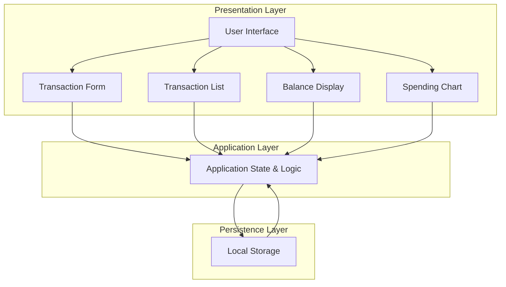
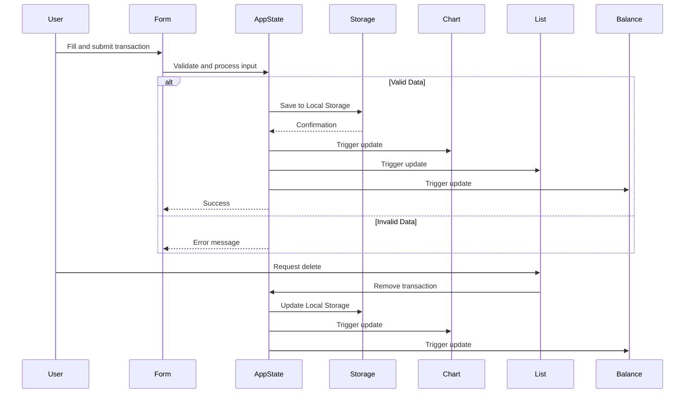
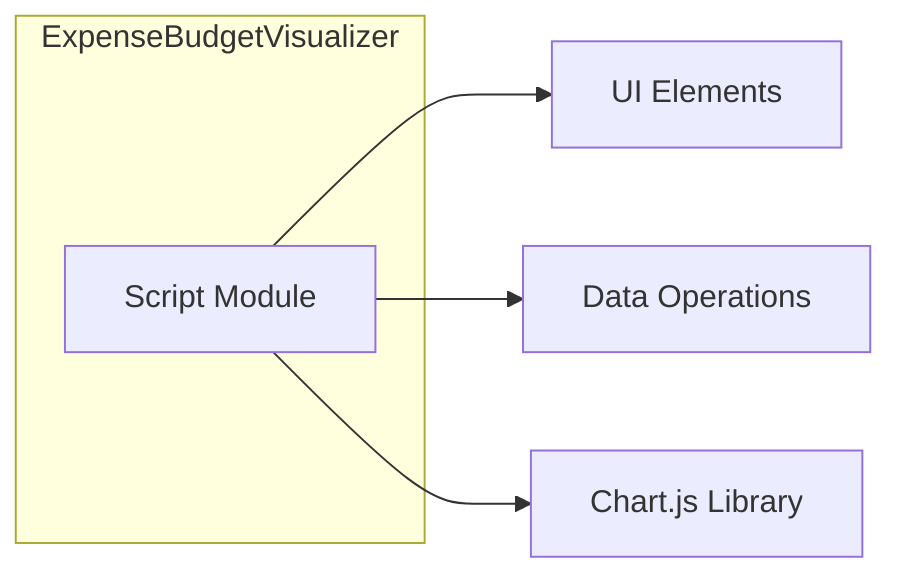
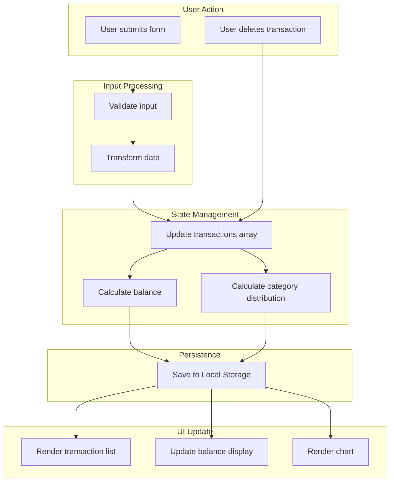

# Expense & Budget Visualizer - Technical Design Document

## Overview

The Expense & Budget Visualizer is a client-side web application that helps users track daily expenses and visualize spending patterns. The application uses vanilla HTML, CSS, and JavaScript with Local Storage for data persistence. This design document outlines the architecture, components, data models, and implementation strategy.

### Key Design Decisions

1. **Vanilla JavaScript**: No framework dependencies for simplicity and minimal bundle size
2. **Local Storage**: Browser-native persistence without backend infrastructure
3. **Single JavaScript File**: All logic consolidated in js/script.js for maintainability
4. **Data-Driven UI**: State management pattern where UI updates from data changes
5. **Chart.js CDN**: Use Chart.js library for pie chart visualization

### Technology Stack

| Layer | Technology | Rationale |
|-------|-----------|-----------|
| Markup | HTML5 | Semantic structure |
| Styling | CSS3 | Flexbox/Grid layout, single CSS file |
| Logic | ES6+ JavaScript | Vanilla implementation in single file |
| Storage | Web Local Storage API | Browser-native persistence |
| Rendering | DOM API | Native browser capabilities |
| Charting | Chart.js via CDN | Simple pie chart implementation |

---

## Architecture

### System Architecture Diagram



### Component Interaction Diagram



---

## Components and Interfaces

### High-Level Component Structure



### Component Descriptions

#### Script Module (`js/script.js`)
- All application logic consolidated in a single file
- Input validation functions
- Local Storage operations
- DOM manipulation and rendering
- Chart.js integration and updates
- Event handler setup

---

## Data Models

### Transaction Data Model

```javascript
{
  id: "string-uuid",           // Unique identifier
  itemName: "string",          // Description of expense
  amount: "number",            // Expense amount (positive)
  category: "string",          // One of: 'Food', 'Transport', 'Fun'
  createdAt: "string-iso-date" // ISO 8601 timestamp
}
```

### State Model

```javascript
{
  transactions: [
    {
      id: "string",
      itemName: "string",
      amount: number,
      category: "string",
      createdAt: "string"
    }
  ]
}
```

### Category Configuration

```javascript
const CATEGORIES = ['Food', 'Transport', 'Fun'];
```

---

## File Organization

### Directory Structure

```
css/
  └── style.css              # All CSS styles (single file)

js/
  └── script.js              # All JavaScript logic (single file)

index.html                   # Main HTML file with Chart.js CDN
```

### File Responsibilities

#### `index.html`
- Main document structure
- Chart.js CDN import
- Form elements
- Chart container (canvas element)
- Transaction list container
- Balance display elements

#### `css/style.css`
- Layout styles (Flexbox/Grid)
- Form styling
- Transaction list styling
- Chart styling
- Responsive design

#### `js/script.js`
- Application initialization
- Event listener setup
- Input validation functions
- Local Storage CRUD operations
- Balance calculations
- Chart data aggregation
- Chart.js pie chart initialization and updates
- DOM manipulation and rendering
- State management

---

## Data Flow

### Data Flow Diagram



### Detailed Data Flows

#### 1. Add Transaction Flow

```
User Input → Validation → Data Transformation → State Update
    ↓
Local Storage Save
    ↓
UI Updates (List + Balance + Chart)
```

#### 2. Delete Transaction Flow

```
User Action → State Update → Local Storage Save
    ↓
UI Updates (List + Balance + Chart)
```

#### 3. Page Load Flow

```
Document Ready → Load from Local Storage → Calculate Derived Data
    ↓
Render UI (List + Balance + Chart)
```

---

## Algorithm Descriptions

### Balance Calculation Algorithm

```
1. Initialize total = 0
2. For each transaction in transactions:
   - Add transaction.amount to total
3. Format total as Indonesian Rupiah (Rp prefix, comma separator)
4. Return formatted string
```

### Chart Data Aggregation Algorithm

```
1. Initialize category totals: {Food: 0, Transport: 0, Fun: 0}
2. For each transaction in transactions:
   - Add transaction.amount to category.total
3. Calculate total spending (sum of all categories)
4. For each category:
   - Calculate percentage = (category.total / total) * 100
5. Return category data with totals and percentages
```

### Chart.js Pie Chart Implementation

```javascript
// Initialize chart instance
const ctx = document.getElementById('expenseChart').getContext('2d');
let expenseChart = new Chart(ctx, {
  type: 'pie',
  data: {
    labels: ['Food', 'Transport', 'Fun'],
    datasets: [{
      data: [0, 0, 0],
      backgroundColor: ['#FF6384', '#36A2EB', '#FFCE56'],
      borderWidth: 1
    }]
  },
  options: {
    responsive: true,
    plugins: {
      legend: {
        position: 'bottom'
      }
    }
  }
});

// Update chart with new data
function updateChart() {
  const categoryData = calculateCategoryTotals();
  expenseChart.data.datasets[0].data = [
    categoryData.Food,
    categoryData.Transport,
    categoryData.Fun
  ];
  expenseChart.update();
}
```

### Local Storage Persistence Algorithm

```
For Save:
1. Convert transactions array to JSON string
2. Store in localStorage with key 'transactions'
3. Store balance calculation timestamp

For Load:
1. Retrieve 'transactions' from localStorage
2. Parse JSON string to array
3. If empty, initialize with empty array
4. Return transactions array
```

---

## Component Relationships

### Script Structure

```
┌─────────────────────────────────────────────────────────────┐
│                      js/script.js                            │
├─────────────────────────────────────────────────────────────┤
│  • init() - Application initialization                       │
│  • loadState() - Load data from Local Storage               │
│  • saveState() - Save state to Local Storage                │
│  • validateInput() - Input validation                        │
│  • addTransaction() - Add new transaction                   │
│  • deleteTransaction() - Remove transaction                 │
│  • renderTransactions() - Render transaction list           │
│  • updateBalance() - Calculate and display balance          │
│  • updateChart() - Update Chart.js pie chart                │
└─────────────────────────────────────────────────────────────┘
```

---

## Correctness Properties

*This feature does not involve property-based testing (PBT). PBT is appropriate for pure functions with universal properties across input spaces. This application primarily involves UI rendering, Local Storage operations, and simple calculations that are better tested with example-based and integration tests.*

**Why PBT is not applicable:**
- UI rendering and layout: Uses DOM manipulation which is better tested with snapshot/visual regression tests
- Local Storage persistence: Declarative configuration that's better tested with smoke tests
- Simple calculations: Balance and aggregation logic can be tested with example-based unit tests
- Input validation: Best tested with specific examples and edge cases

**Alternative Testing Strategy:**
- Unit tests: Example-based tests for balance calculations, validation functions
- Integration tests: End-to-end workflow testing
- Snapshot tests: UI rendering verification
- Manual QA: User interaction testing

### Property 1: UI rendering and Local Storage operations

*This application primarily involves UI rendering, Local Storage operations, and simple calculations that are better tested with example-based and integration tests rather than property-based testing. The acceptance criteria in Requirements 1-7 are validated through UI testing, integration testing, and manual QA.*

**Validates: Requirements 1.1, 1.2, 1.3, 1.4, 1.5, 2.1, 2.2, 2.3, 2.4, 2.5, 3.1, 3.2, 3.3, 3.4, 4.1, 4.2, 4.3, 4.4, 4.5, 5.1, 5.2, 5.3, 5.4, 5.5, 6.1, 6.2, 6.3, 6.4, 7.1, 7.2, 7.3, 7.4, 7.5, 7.6**

---

## Error Handling

### Error Categories

1. **Validation Errors**
   - Empty required fields
   - Invalid amount values
   - Invalid category values

2. **Storage Errors**
   - Local Storage unavailable
   - Data corruption
   - Quota exceeded

3. **Rendering Errors**
   - Invalid data format
   - DOM manipulation failures

### Error Handling Implementation

```javascript
// Validation errors
try {
  validateTransaction(formData);
} catch (error) {
  ui.showError(error.message);
  return;
}

// Storage errors
try {
  data.saveToLocalStorage(transactions);
} catch (error) {
  console.error('Storage error:', error);
  ui.showError('Unable to save data. Please try again.');
}

// Rendering errors
try {
  ui.renderChart(categoryData);
} catch (error) {
  console.error('Rendering error:', error);
  ui.showError('Unable to display chart.');
}
```

---

## Testing Strategy

### Unit Tests

| Functionality | Test Coverage | Method |
|--------------|--------------|--------|
| Input validation | All validation scenarios | Jest/Mocha |
| Balance calculations | Calculation accuracy | Jest/Mocha |
| Chart data aggregation | Category totals and percentages | Jest/Mocha |

### Integration Tests

| Scenario | Test Type |
|----------|-----------|
| Add transaction | Manual/QA |
| Delete transaction | Manual/QA |
| Page load with data | Manual/QA |
| Local Storage persistence | Manual/QA |
| Chart.js rendering | Manual/QA |

### Manual Testing Checklist

- [ ] Add transaction with valid data
- [ ] Add transaction with empty fields (error)
- [ ] Add transaction with negative amount (error)
- [ ] Delete existing transaction
- [ ] Page reload preserves data
- [ ] Balance updates correctly
- [ ] Chart updates with new data
- [ ] All categories display correctly
- [ ] Chart.js pie chart renders properly

---

## Browser Compatibility

| Browser | Version | Notes |
|---------|---------|-------|
| Chrome | Latest | Full support |
| Firefox | Latest | Full support |
| Edge | Latest | Full support |
| Safari | Latest | Full support |

### Fallback Considerations

- Local Storage API: Required (no fallback)
- ES6+ features: Target modern browsers
- CSS Grid/Flexbox: Modern layout support

---

## Security Considerations

1. **Input Sanitization**: Prevent XSS through proper escaping
2. **Local Storage**: No sensitive data stored (by design)
3. **Cross-Site Scripting**: Escape user input before rendering

---

## Future Enhancement Possibilities

1. **Export Functionality**: Download transaction history as CSV
2. **Multiple Currencies**: Support currency conversion
3. **Category Management**: Allow custom categories
4. **Date Filtering**: Filter transactions by date range
5. **Statistics**: Monthly/annual spending reports
6. **Dark Mode**: Theme toggle

---

## Conclusion

This design provides a clear roadmap for implementing the Expense & Budget Visualizer as a lightweight, client-side web application. The modular architecture ensures maintainability, while the Local Storage-based persistence eliminates backend complexity. The design emphasizes simplicity, performance, and user-friendly interaction patterns.